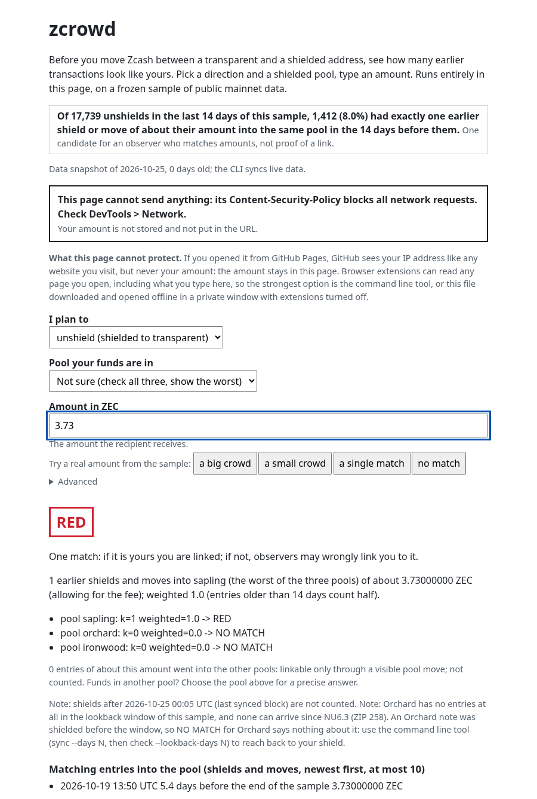

# zcrowd

**Before you shield or unshield Zcash, see how many other transactions look like yours: offline, on your own machine, before anything is sent.**



An unshield (money leaving a shielded pool) shows its amount in public, and so did the shield it came from. If nobody else
shielded about that amount around that time, an observer can pair the two. zcrowd reads the public record of every shield,
unshield and move between the shielded pools (Sapling, Orchard, Ironwood) and tells you, before you send, how many earlier
entries look like your amount. It is a Rust command line tool, a small library (`zcrowd-core`, for wallets) and a one-file
web page. It computes only what any chain observer can already compute, for your own transaction, on your own machine.

| | |
|---|---|
| Track | ZECATHON, CORE & TOOLING. Licence: MIT (`LICENSE`). |
| AI disclosure | Built by an AI agent team (Claude) for its author. |
| Rust | 1.90 or newer (`rust-version` in `Cargo.toml`; `cargo +1.90.0 check --workspace --all-targets --locked` passes). The tests and the audit ran on 1.97.1, the version CI pins (the repository has no `rust-toolchain` file, so your own toolchain is used); the tests under 1.90 are NOT VERIFIED. A C compiler is needed (SQLite is bundled). |
| First build | 76 s for `cargo build --release --locked` from an empty target directory (2026-10-25, Debian 13, 20 cores, 62 GB RAM, crates already downloaded; a second run the same day, with other jobs using the machine (load average 4 before it started), took 101 s; a first build elsewhere also downloads the crates). |
| Platform | Tested on Linux. macOS and Windows are NOT VERIFIED (end of this file). |
| Tested code | Commit `dd7f9ee` (called the final code below). Unless a line names another build, the example outputs and the test and audit results in this README are of that commit; the commits after it change documents only. |
| Data | `fixtures/flows-sample.ndjson`: 74,643 real mainnet events, blocks 3,493,237 to 3,529,525 (2026-09-23 08:32 UTC to 2026-10-25 00:05 UTC, 31.65 days). The quick start and every example below run on it without a network. |

1. [The leak](#1-the-leak)
2. [Quick start](#2-quick-start-bundled-sample-no-network)
3. [Check the privacy claims in five minutes](#3-check-the-privacy-claims-in-five-minutes)
4. [Fresh data: sync, with measured times](#4-fresh-data-sync-with-measured-times)
5. [How it works](#5-how-it-works)
6. [Real output](#6-real-output)
7. [For wallet developers: `--json` and the library](#7-for-wallet-developers---json-and-the-library)
8. [Privacy: what leaves your machine](#8-privacy-what-leaves-your-machine)
9. [Trust: the lightwalletd server is not trusted](#9-trust-the-lightwalletd-server-is-not-trusted)
10. [Prior work](#10-prior-work)
11. [Honest limits](#11-honest-limits)
12. [How it is verified](#12-how-it-is-verified)
13. [Web page](#13-web-page)
14. [Dependencies, licence, roadmap](#14-dependencies-licence-roadmap), then [NOT VERIFIED](#not-verified)

## 1. The leak

Shielded balances are private. The moment money crosses between the transparent pool and a shielded pool, the amount and
the time are public. If you shield 3.73 ZEC and later unshield about 3.73 ZEC, and nobody else shielded about that amount
in between, an observer who matches by amount has one candidate for the other half of the pair. Nothing is broken; the
amount is the fingerprint. Whether your amount hides in a crowd depends on how many other shields of about that amount
went into the same shielded pool before it: a shield into Sapling is no cover for an unshield out of Ironwood.

Measured on the committed sample. Each of the 17,739 unshields of the last 14 days is scored against the entries
(shields and moves) into its own pool in the 14 days before it:

| verdict | unshields | share | what an observer who matches by amount finds |
|---|---|---|---|
| NO MATCH | 3,695 | 20.8% | no earlier entry of about that amount into its pool in the 14 days before |
| RED | 1,412 | 8.0% | exactly one earlier entry of about that amount: one candidate |
| AMBER | 2,541 | 14.3% | two to nine earlier entries: a small crowd |
| GREEN | 10,091 | 56.9% | ten or more earlier entries |
| all | 17,739 | 100% | |

So for 8.0% of recent unshields an amount-matching observer has exactly one earlier entry to look at. That does not prove
that the two transactions belong to one person; it shows the size of the crowd an observer would face. Of the 70,981
shields and unshields in the report (30,783 shields and 40,198 unshields; its 74,491 events also hold 3,510 moves between
pools), 37,798 (53.3%) have an amount that no other shield or unshield shares. 157 of the NO MATCH unshields left Orchard:
the data holds no shield or move into Orchard, and none can arrive since NU6.3 (ZIP 258), so their NO MATCH says nothing
about them (section 11). Reproduce (the rows come from `report.html`, which `tests/e2e.sh` also checks):

```
zcrowd report --data fixtures/flows-sample.ndjson
```

```
wrote report.html (74491 events)
```

## 2. Quick start (bundled sample, no network)

```
git clone https://github.com/Kylne700/zcrowd
cd zcrowd
cargo build --release --locked
export PATH="$PWD/target/release:$PATH"
printf '1.0\n' | zcrowd check --unshield - --data fixtures/flows-sample.ndjson
```

This uses no network: `check` has no network code and cuts its own network first (section 3). The `-` after `--unshield`
makes it read the amount from stdin so that this example can be pasted. For your own amount run
`zcrowd check --unshield --data fixtures/flows-sample.ndjson` without a value and type the amount at the prompt: nothing
is shown while you type, and it does not land in your shell history or in the process list. Real output (26 lines, all of
them; the ten match lines are the newest entries of about 1.0 ZEC):

```
check: unshield (recipient gets this amount); pool any (worst of sapling, orchard, ironwood); fee allowance 50000 zat, tolerance 0 zat, lookback 30 days
data: blocks 3493237..3529525 (2026-09-23 08:32 UTC .. 2026-10-25 00:05 UTC), 74643 events
skipped: no_net_crossing 4, no_transparent_part 8 (not shields or unshields: nothing crossed the turnstile)
warning: the newest block in this data is 4.6 h old; shields since 2026-10-25 00:05 UTC are not counted (run `zcrowd sync`)
pool sapling: k=0 weighted=0.0 -> NO MATCH
pool orchard: k=0 weighted=0.0 -> NO MATCH
pool ironwood: k=160 weighted=111.0 -> GREEN
crowd: k=160 weighted=111.0 (pool ironwood, the worst of the three: earlier shields and moves into it of about this amount, allowing for the fee; entries older than 14 days count half)
other pools: 0 entries of about this amount went into the other pools: linkable only through a visible pool move; not counted
matches (newest first, up to 10):
  2026-10-24 20:48 UTC  3.3 h ago  1.00000000 ZEC  50157c17a521923fbeb24d0e2694c1cb31e66618ffdedb01413e63264c1ba177
  2026-10-24 16:28 UTC  7.6 h ago  1.00000000 ZEC  1c0fd2d68365cb291e8ea199e7a0483e05a3b8d80fb85e3698cd353ef63316c9
  2026-10-24 05:23 UTC  18.7 h ago  1.00000000 ZEC  4cfce7c4bc883107e979f069d213f2780a305b355a0ce9818bc1cef9403c9fd5
  2026-10-23 15:00 UTC  33.1 h ago  1.00000000 ZEC  74e2452adb96473fbf2014287b75eea2d19d32d6a0952b4ec78ded4658c93174
  2026-10-23 13:07 UTC  35.0 h ago  1.00024444 ZEC  7baf7c61d53ed4c367529e09fa19315d1d1928d23c2a48af4828dce524e68804
  2026-10-23 12:17 UTC  35.8 h ago  1.00000000 ZEC  e3166e9a4a6824fcbe0188087e6244d73ef13f7138a94f72c3fddefd210ec733
  2026-10-23 04:40 UTC  43.4 h ago  1.00000000 ZEC  83542ab92a09b4c3e975a9d3f16f8e6dc84aa7c9492700bc0a94cd3aab9f541c
  2026-10-22 17:40 UTC  2.3 days ago  1.00000000 ZEC  43e98ba8aa56271c2e528825eaa02a4a99aa4d5132160d5cb80c7e2e44e17fb1
  2026-10-21 13:54 UTC  3.4 days ago  1.00048745 ZEC  39aeff6f91a456516f55b9bf345f3e7e170c49086e24d3fa0d7da95de18a177f
  2026-10-21 13:48 UTC  3.4 days ago  1.00000000 ZEC  6936b3a657054f0d0cfeb4190e5112fe010e682e0a193004ef5a93e312ea7bd1
verdict: GREEN - big crowd for amount + timing only, not "private"
shields after 2026-10-25 00:05 UTC (last synced block) are not counted
note: orchard has no entries at all in this window, and none can arrive since NU6.3 (ZIP 258). An Orchard note was shielded before the window, so NO MATCH for orchard says nothing about it: sync more days (sync --days N) and check with --lookback-days N to reach back to your shield
funds in another pool? use --pool for a precise answer
Not checked: address reuse. Never unshield to an address you shielded from (add --to -).
Covers amount + timing within one pool (+ address reuse with --to). Not covered: wallet/fee fingerprints, your IP when your wallet broadcasts (use Tor in your wallet), the z->z graph, links through pool moves beyond their amounts, off-chain records.
```

How to read it. The three `pool` lines are the point: an observer ties an unshield only to entries into the same pool.
1.0 ZEC has 160 entries into Ironwood and none into Sapling or Orchard, so `--pool ironwood` says GREEN and
`--pool sapling` says NO MATCH (nothing of that amount for an observer to match). With the default `--pool any` the single
`verdict:` line is the worst of the pools, here GREEN. GREEN means a big crowd for amount and timing only, not "private".
The `warning:` line about the age of the newest block depends on your clock: `check` prints it when that block is more than
2 hours old. The newest block of the sample is from 2026-10-25 00:05 UTC, so every check on the sample prints it from
02:05 UTC on that day, and the age grows every hour (after two days it is printed in days). Fetch fresh data (section 4)
and the warning goes away; the `shields after ... are not counted` line stays, because a shield made after the newest
synced block cannot be seen. If your computer's clock is more than 3 hours behind the newest block, or more than a year
after it, `check` adds a warning about the clock: the first says "the clock is wrong, so how old the data is cannot be
judged", the second says the data is out of date or the clock is wrong. Both start with
`warning: this computer's clock (...)`.

Other flags: `--pool sapling|orchard|ironwood|any` (the pool your funds are in; the default `any` scores every pool and
prints the worst), `--shield X` (you plan to shield: X is the amount that arrives in the pool, what you shield minus the
fee, not what your wallet sends), `--to ADDRESS` (address reuse, section 5), `--lookback-days`, `--tolerance-zat`,
`--fee-allowance-zat`, `--json` (section 7). `zcrowd report` writes one self-contained HTML file. `zcrowd verify`
recomputes one event from its raw transaction (section 9).

The numbers have limits, all shown in `--help`: `--lookback-days` and `sync --days` take 1 to 3650, `--tolerance-zat` and
`--fee-allowance-zat` 0 to 100000000 (1 ZEC). A value outside them is refused before anything is read: exit status 2,
nothing on stdout. Real output (stderr) of `zcrowd check --unshield - --lookback-days 0`:

```
error: invalid value '0' for '--lookback-days <LOOKBACK_DAYS>': 0 is not in 1..=3650

For more information, try '--help'.
```

The test is `numeric_options_have_limits_and_huge_values_are_refused_not_crashed`; the library itself neither panics nor
overflows on the largest values (`huge_parameters_neither_panic_nor_overflow`).

## 3. Check the privacy claims in five minutes

You do not have to believe this README. These checks run on your machine, cheapest first; the first one needs no build.
Linux is the tested platform (the audit uses user namespaces); on macOS the audit and the namespace demo are NOT VERIFIED.
The complete list of claims, each with the check that can fail, is `docs/PRIVACY.md`. What these checks do not cover is in
section 11.

### 3.1 The web page cannot send anything (no build needed)

The SHA-256 of `web/index.html` as committed. To use the page offline from a copy you did not build yourself, compare
your copy with this value; the Pages workflow publishes this file unchanged, and audit P10 checks that it is exactly what
`node web/build.mjs` builds from the template and the sample.

```
sha256sum web/index.html
```

```
3da4d6c73daa1b7762a9374fbc6e634114aaad400975d4a89d806c59d343be96  web/index.html
```

(macOS: `shasum -a 256 web/index.html`.) Open the file in a browser (a private window with extensions off is the
strongest setup, section 13), open the developer console and try to send something:

```
fetch("https://example.com/")
```

The call fails. The page's Content-Security-Policy, a `<meta>` tag in the file, is:

```
<meta http-equiv="Content-Security-Policy" content="default-src 'none'; script-src 'unsafe-inline'; style-src 'unsafe-inline'; img-src data:; connect-src 'none'; form-action 'none'; base-uri 'none'">
```

Headless Chromium 154 (2026-10-25, `file://`) printed these two console messages and rejected the call with
`TypeError: Failed to fetch`; the same run counted 1 network request (the file itself) at load and 0 while the amount was
typed (other browsers word the messages differently, and the Network tab of your DevTools should show the same counts):

```
Connecting to 'https://example.com/' violates the following Content Security Policy directive: "connect-src 'none'". The action has been blocked.
Fetch API cannot load https://example.com/. Refused to connect because it violates the document's Content Security Policy.
```

### 3.2 The offline audit: every claim, one check each

```
bash tests/audit.sh
```

It needs Linux, git, python3, a C compiler and the Rust toolchain, builds the project first, and needs no network. Without
`PLAYWRIGHT_CORE` (a `playwright-core` directory, which adds the headless-browser test of the page) and without `LIVE=1` (a
real Tor sync under a recorder of every name lookup and connection, section 8) two checks are skipped and printed as
`SKIP ... (NOT VERIFIED)`. Output on a cold target directory, crates already downloaded, 144 s, exit 0 (2026-10-25; a second run in a fresh clone
took 167 s and printed the same lines; lines cut at 120 characters; the commit count in the P11 line is higher in a clone
that has more commits):

```
ok    build
ok    P1 sync requests depend only on the block range (test sync_requests_depend_only_on_range)
ok    P2 check, report and verify run with the network removed from outside (unshare -rn)
ok    P2 check.rs, report.rs and verify.rs import no network code (no source, tonic, tokio, std::net, Lwd, sockets)
ok    P2 the process cuts its own network: a loopback connection works before and fails after (test sandbox_blocks_conne
ok    P2 the seccomp filter refuses TCP, UDP, Unix sockets, socketpair, io_uring and other ABIs, through enter() and alo
ok    P2 check, report and verify each install the seccomp filter before they read their data (test check_report_and_ver
ok    P3 only ingest.rs (raw cache), model.rs (the flows files, called by sync only), report.rs (report), sync.rs (lock 
ok    P3 random address and amount typed via stdin and arguments: not in any file, no file created, neither echoed in th
ok    P4 no mnemonic, seed, viewing-key or ufvk anywhere in crates/
ok    P5 525 crate versions in cargo tree (624 packages in Cargo.lock), none of reqwest, sentry, posthog, segment, opens
ok    P6 sync --server http://... is refused before any connection (run with the network removed)
ok    P6 a local TLS server with a self-signed certificate is rejected (invalid peer certificate: UnknownIssuer)
ok    P7 flows file keys, cache file names and the directory listing contain only public chain fields
ok    P8 wrong txid dropped and counted, broken prevHash and gaps are errors (tests wrong_or_broken_transactions_are_dro
ok    P9 report HTML has no src, href, url(), http(s), @import or script
ok    P10 web/index.html: CSP with connect-src, form-action, base-uri none; no external reference; no network, storage o
ok    P10 PARITY OK: 1008 JS-vs-Rust comparisons (128 sample amounts, 20 rejected inputs, synthetic edge suite); identic
ok    P10 web/index.html equals what web/build.mjs builds from the template and the committed sample
SKIP  P10 headless browser test (set PLAYWRIGHT_CORE to a playwright-core directory) (NOT VERIFIED)
ok    P11 no home path, mail address or personal string in tracked or untracked files; 94 commits, one neutral identity;
ok    T1/T2/T5/T7 empty network namespace: the default sync fails loudly (names --no-tor), looks up no server name, reso
SKIP  T3/T4/T6 live Tor leak check and Tor directory contents (needs the network and a C compiler: LIVE=1 bash tests/aud
AUDIT OK (2 check(s) skipped and NOT VERIFIED, see the SKIP lines above)
```

Each `ok` line is one claim and the check behind it; `AUDIT OK` is printed only if every line is ok. With
`PLAYWRIGHT_CORE` set (setup in section 12) the P10 headless line is ok instead of SKIP, and with `LIVE=1` the T3/T4/T6
line shows what a real Tor sync did (236 s for the whole audit on 2026-10-25: 23 ok lines, no SKIP).

### 3.3 `check`, `report` and `verify` cut their own network

At start, before they read any data, these three commands remove their own network: on Linux an empty network
namespace (where user namespaces are allowed) and always a seccomp filter that refuses every new socket. On a terminal
the first line on stderr says which layers are in place (with all layers in place the note is printed only when stderr
is a terminal, so that `--json` output piped with `2>&1` stays plain JSON; when a layer is missing it is always printed).
Typing the amount privately, as in section 2, the terminal shows:

```
zcrowd check --unshield --data fixtures/flows-sample.ndjson
```

```
note: network cut for this command: empty network namespace + seccomp socket filter
Amount in ZEC (not shown): 
```

To see the cut work, the test helper `sandbox-probe` connects to a TCP address, once as it is and once after entering the
same sandbox. Start a listener on this machine and try both (the second line of each pair is what the command printed
on 2026-10-25; with nothing listening the first command prints `blocked: Connection refused (os error 111)`):

```
python3 -I -m http.server 8765 --bind 127.0.0.1 &     # note the process id, stop it with kill when you are done
zcrowd sandbox-probe 127.0.0.1:8765
zcrowd sandbox-probe 127.0.0.1:8765 --sandbox
```

```
connected
blocked: Operation not permitted (os error 1)
```

### 3.4 A sync without a network is refused and writes nothing

Two refusals that need no real server. Plain `http://` is refused before any connection (and before Tor starts); in an
empty network namespace, `--no-tor` fails at the name lookup and creates no output (`unshare -rn` is Linux only):

```
zcrowd sync --days 1 --server http://example.com:80 --out "$(mktemp -d)/flows.ndjson"
unshare -rn zcrowd sync --no-tor --days 1 --out "$(mktemp -d)/flows.ndjson"
```

```
Error: refusing a plain-text connection to http://example.com:80: use https:// (http:// is only allowed for a lightwalletd on this machine)

warning: --no-tor: connecting directly. The server sees your IP address and that you run zcrowd.
Error: server https://eu.zec.rocks:443

Caused by:
    0: transport error
    1: dns error
    2: dns error
    3: failed to lookup address information: Temporary failure in name resolution
```

Exit status 1 both times, and the output directories are empty. The default (Tor) route in an empty namespace is checked
by audit T1/T2 (the line `ok T1/T2/T5/T7 ...` above): it fails loudly, names `--no-tor`, looks up no server name and
writes no output; it never falls back to a direct connection. By hand under `unshare -rn` arti refuses its state
directory (`Bad owner (UID 65534) on file or directory "/"`: inside the namespace `/` is owned by nobody), so use the
test, not a hand run, for that case.

## 4. Fresh data: sync, with measured times

```
zcrowd sync                                    # the last 30 days, over Tor: data/flows.ndjson, data/flows.meta.json, data/tx/
zcrowd sync --days 1 --out day/flows.ndjson    # one day, into another directory
```

`sync` is the only command that uses the network. It asks the first server that answers as a mainnet lightwalletd
(`--server`, repeatable; the default list is `https://zec.rocks:443`, `https://na.zec.rocks:443` and
`https://eu.zec.rocks:443`) for the compact blocks of the last N days (`--days`, 1 to 3650, default 30), picks the
transactions that cross the turnstile or move value between shielded pools, fetches each in full and recomputes its id
from the bytes (section 9). It fetches about 5% more blocks than N days of 75-second blocks (at least 144 blocks, about
three hours), so `--days 30` is 36,289 blocks, which is 31.65 days in the sample, and it stops 10 blocks below the tip
(a reorg margin). Every request goes through Tor by default: the Rust Tor client arti is built into the program, there
is nothing to install. `--no-tor` goes direct and prints a warning that the server then sees your IP address and that you
run zcrowd. `sync` never falls back to a direct connection when Tor fails, and it refuses a plain `http://` server
except a lightwalletd on this machine. Run it on a schedule, not right before you transact.

Real output of a 30-day sync over Tor (started 2026-10-25 00:21 UTC, release build `f90836d`, whose `sync` code is that
of `dd7f9ee`). It fetched 246 of the 74,655 transactions; the rest came from the cache of an earlier 30-day sync, so it
took 236 s and is not a cold run. stdout, exact except that the name of the output directory is written `<out>`:

```
blocks=36289 txs=284182 shield_like=30830 (coinbase 1635) unshield_like=40307 move_like=3518 range=3493237..3529525 secs=178.1
pools: of the 36289 blocks from block 3428143 (NU6.3) on, 5803 hold Sapling data, 2659 Orchard, 23266 Ironwood
tree check: the server's tree states (blocks 3493236 and 3529525) grew by Sapling 16169, Orchard 11398, Ironwood 325664 note commitments, exactly what its blocks hold
events=74643 shields=30783 unshields=40350 moves=3510 fetched_txs=246 cached_txs=74409 secs=213.3
excluded: no_net_crossing=4 no_transparent_part=8 multi_pool(kept, low confidence, not counted in crowds)=152
integrity: transaction id recomputed from the raw bytes for 74655 of 74655 candidates, 0 did not match (dropped); block hash chain checked over 36289 blocks
wrote <out>/flows.ndjson (raw transactions cached in <out>/tx)
tip: sync on a schedule, not right before you transact. The server learns nothing about your wallet, and over Tor (the default) it does not see your IP address either; with --no-tor it does.
```

stderr is progress only (heights and counts): 23 lines, here the first four and the last two (the others are
`sync: blocks N of 36289 (P%)`, one per 2,000 blocks):

```
starting Tor; the first run can take a minute
server: https://zec.rocks:443 (via Tor)
sync: fetching blocks 3493237..3529525
sync: blocks 2000 of 36289 (5%)
sync: blocks 36289 of 36289 (100%)
sync: fetching up to 74655 transactions (the ones already saved are not fetched again)
```

When 40 s pass without a `sync:` line, a status line says the sync is alive, for example (from the 16-day run below):
`sync: still fetching transactions: 269 of up to 37986 so far (5 min 6 s in)`. The `still fetching blocks` form of
that line is only seen in a unit test (NOT VERIFIED live). `pools:` counts, per pool, the blocks since NU6.3 that hold
data of that pool, and `tree check:` compares how many note commitments the server's own tree states say were added
between the first and the last block with what its blocks hold, per pool: a server that leaves a pool out of its blocks
is refused (section 9). A server that serves no tree states gets, in place of that line, `tree check: none, the server serves no tree states (a pool with no data in more than 1000 blocks from NU6.3 on is refused instead)` (the text is read from `sync.rs`; no run of this README printed it). `excluded:` lists what was left out: the 152 multi-pool events are kept in the file as low confidence and never counted in a
crowd, and the skipped transactions are the counts of the `skipped:` line `check` prints. A transaction whose books
do not close (transparent in plus value balances must equal transparent out plus fee, fee at least 0) is skipped and
counted, never clamped; a reason that could hide a shield or an unshield (`conservation_fails`, `sprout_value`,
`txid_mismatch`, `undecodable`) makes `check` print a `warning:` instead. Merged syncs count the overlapping blocks twice,
so the skipped counts can over-report, never under-report.

Stop and resume. Ctrl-C or SIGTERM stops a sync with `sync: stopped by SIGINT. <out> is as it was, and the transactions already fetched are kept in <out dir>/tx: run the same command again to go on.`
(exit status 130 or 143); the same command then goes on from `tx/`. A block stream that breaks in the middle of a range
is opened again after the last block received, with the hash chain checked across the join (at most 5 failed attempts
in a row and 20 in all, and 60 s without data counts as a failure). The files are written crash-safe: both are first written
whole to `flows.tmp` and `flows.meta.tmp` (the names for the default `--out`), the old coverage file `flows.meta.json` is
removed, then the events file is renamed into place and the new coverage file last, so an interrupted save leaves the old
pair or a clear refusal (``no coverage file next to the data (an interrupted sync?): run `zcrowd sync` again``; the tests are
`a_save_that_fails_before_the_events_are_replaced_keeps_the_old_pair` and `a_save_that_stops_between_the_two_renames_leaves_no_window_to_trust`). A second sync on the same `--out` stops with
`another zcrowd sync is already writing <out> (lock file <path>): wait for it to finish` (the lock is held on the empty
file `flows.lock`, which stays on disk and is released when the process ends, even if it is killed). Data from another
zcrowd version (`FORMAT_VERSION` 2) is refused by `check`, `report` and `verify` with ``run `zcrowd sync` again`` (tests `check_and_report_refuse_data_without_this_format_version`, and for `verify` the last assert of `verify_reads_the_id_from_stdin_notes_one_in_the_arguments_and_advises_spot_checks`); a damaged line is reported with its line
number (`Error: cannot read <file>`, then `line 4, column 17: EOF while parsing a value`).

Syncing into data you already have. If `--out` holds data of this version and the new block range overlaps it or touches it
(the first block of one follows the last of the other), the two are merged: events inside the new range are replaced, older
ones are kept, and the coverage file records both ranges as one. If the new range does not touch the old one, a gap would
make the coverage claim false, so the old data is dropped and `sync` prints `note: new range does not touch the existing
data; replacing it`. Data without a usable coverage file of this version (an older zcrowd, an interrupted sync) is never
merged: `note: the existing data has no usable coverage file of this zcrowd version; replacing it`. Only that last case
has a test (`sync_replaces_data_of_another_version_and_stores_the_format_version_and_skipped_counts`); the merge and the
no-touch case are read from `crates/zcrowd/src/sync.rs` and not tested (NOT VERIFIED, end of this file). The first and last
times of the coverage are the earliest and the latest block time seen, because block times are not monotonic
(`the_windows_times_are_the_extremes_of_the_block_times_not_those_of_its_edge_blocks`). A cached raw transaction that is
not valid hex is fetched again and overwritten; it does not stop the sync (`a_corrupt_cache_file_is_fetched_again_and_overwritten`).

Tor details. `sync` opens 4 connections, each an isolated Tor client with its own circuit, each replaced after 10
minutes, with at most `--concurrency` requests in flight (default and maximum 8). Transactions are fetched out of order
and written in candidate order, so the file is byte-identical to the one `--no-tor` writes (the `flows.ndjson` of 18
one-day runs, Tor and direct, has one SHA-256). The 4 connections and the 10 minutes are guesses that were never tuned,
and up to 4 exit relays see one sync. The Tor state directory (`--tor-dir`, default `$XDG_CACHE_HOME/zcrowd/tor` or
`~/.cache/zcrowd/tor`; `%LOCALAPPDATA%\zcrowd\tor` on Windows, NOT VERIFIED) is about 39 MB. A bad certificate over Tor
stops the sync (checked by hand on 2026-10-24, on a build from before the final code and not repeated on it, against
badssl.com hosts: `invalid peer certificate: certificate not valid for name` and `UnknownIssuer`, exit status 1, no data
file, no direct fallback). An expired certificate was refused with
`certificate expired` in an earlier test (0.8 s direct, 3.8 s over a warm Tor) and timed out twice in a later one, so that case is
NOT VERIFIED as repeatable. In one test the first connection
through a freshly started Tor to a host other than `zec.rocks` timed out at the exit after 23 s
(`operation timed out at exit`): the failure is loud and nothing goes direct, so run the command again; whether that
happens to `zec.rocks` is not shown (the cold one-day sync connected at the first attempt).

If the default Tor directory cannot be found (`$XDG_CACHE_HOME` and `$HOME` unset or not absolute paths; on Windows
`%LOCALAPPDATA%`; a relative value is ignored), `sync` stops before Tor starts and does not go direct. Real output with an
empty environment (`env -i`), exit status 1, nothing on stdout and no output directory:

```
Error: no cache directory (XDG_CACHE_HOME and HOME not set, or not an absolute path); pass --tor-dir

Tor was selected, so zcrowd did not contact the server directly and will not fall back to a direct connection. To sync directly instead (the server then sees your IP address), run again with --no-tor.
```

Measured sync times. Machine: Debian 13, 20 cores, 62 GB RAM, shared with other syncs and builds (load average 2 to 12), Tor
state directory new for each run unless the row says otherwise, server `zec.rocks`, all runs on 2026-10-24 unless the
row has another date (UTC). "Build" is the git commit of the release build that ran; `sync.rs`, `source.rs` and
`ingest.rs` are identical at `f90836d`, `5d5ab27` and `dd7f9ee`.

| Range | Route | Build | Date and time | Whole sync |
|---|---|---|---|---|
| 1 day, blocks 3527704..3529000 (1,297 blocks, 2,298 candidates, 55.8 MB) | Tor, one circuit | `eaa45fd` | 21:38 and 21:48 | 578.0 s and 156.0 s |
| same | Tor, 4 circuits, ordered window | `c94b73f` | 22:15 and 22:21 | 330.2 s and 260.2 s |
| same | Tor, 4 circuits, unordered (the code of `dd7f9ee`) | `5d5ab27` | 23:26, both at once, 3 other syncs running | 247.5 s and 170.4 s |
| same | direct (`--no-tor`) | `48fd1a3` | 22:30 | 63.7 s |
| 1 day (2,134 to 2,188 candidates) | Tor, one circuit, new state | an earlier release build | earlier that day | 866 s, and 257 s beside the 30-day run |
| same | Tor, state directory kept | an earlier release build | earlier that day | 571 s |
| same | direct (`--no-tor`) | an earlier release build | earlier that day | 63 s |
| 16 days, blocks 3509647..3529000 (19,354 blocks, 37,986 candidates, 415.6 MB) | Tor, 4 circuits, ordered window | `48fd1a3` | 22:31 | 4,400.1 s = 73 min 20 s (8.63 transactions/s; every 10-minute window 7.6 to 11.5/s) |
| 30 days (36,289 blocks, 75,522 candidates), cold | Tor, one circuit, two processes of one command | an earlier release build | 18:34 to 20:59 | 2 h 25 min (first process stopped after 70 min 30 s) |
| 30 days (34,705 blocks, 67,977 candidates, 61,750 fetched and 6,227 already saved) | direct (`--no-tor`), debug build | an earlier build | 2026-10-24, earlier | 14 s to pick the candidates and 2,048 s to fetch them (34 min) |
| 30 days, warm cache (74,409 of 74,655 transactions already saved) | Tor | `f90836d` | 2026-10-25 00:21 to 00:25 | 236 s (block crawl 178.1 s) |

How to read it. The spread between runs of one build is larger than the differences between builds (the same range took
156 s to 578 s on one circuit and 260 s to 330 s on four), and three paired runs of one circuit against four ran at
16.3/14.0, 5.9/10.8 and 11.3/9.1 transactions per second. So this README does not say the four circuits are faster or
steadier: no gain is shown. The one-day rows of the final code were measured on `5d5ab27`; no multi-day sync of the
final code was run cold (NOT VERIFIED): the 16-day row is of `48fd1a3`, and the cold 30-day row is of an older build
that slowed from 11 to 1.3 transactions per second after 35 minutes (the cause was not found; the 10-minute connection
replacement is a guard, not a shown cure). On the 34,705 blocks that the cold 30-day sync and the direct 30-day sync
of the table both cover, their 67,965 events are identical line for line. The direct 30-day row is of an older
debug build and partly cached, and a cold direct 30-day sync of the final code was not run (NOT VERIFIED). The raw transaction cache is large: 1.59 GB of hex for the
30 days of the sample; the events file is 19.4 MB.

## 5. How it works

```
lightwalletd (public, TLS) --compact blocks--> candidates --full raw tx--> events --> check / report / web
                               block hashes       txid recomputed          offline, no network
                               must chain         from the bytes
```

1. `sync` (section 4) reads the public blocks and turns the shielded transactions into events. The amount of an event
   is read from the exact value balance of each pool, and the books must close (transparent in + value balances =
   transparent out + fee, fee at least 0): a transaction that does not close is skipped and counted, never clamped.
   A **shield** puts value into one pool from the transparent side (or from a coinbase), an **unshield** takes value out
   of one pool to the transparent side, a **move** puts value into one pool and takes it out of one or more others, with
   no transparent output. Anything else that moved value (for example an unshield that pays out of Sapling and Orchard
   at once) is kept as low confidence and never counted in a crowd (152 events in the sample, all unshields). Each event
   stores time, height, kind, amount, pool, txid and the transparent addresses involved, all public on the chain (a
   coinbase has no source address).
2. `check --unshield X` counts the crowd: the entries into your pool, that is shields (a shielded coinbase included) and
   visible moves into it from another pool, within the lookback (`--lookback-days`, default 30) and with an amount in
   `[X, X + 0.0005 ZEC]`. The 0.0005 ZEC (50,000 zat) is `--fee-allowance-zat`: the unshield pays its fee out of the
   shielded note, so the recipient gets slightly less than was shielded. `--tolerance-zat` (default 0) widens the window
   by that many zatoshi in both directions. Entries older than 14 days count half; `weighted` is the sum of the weights.
3. Pools. Ironwood is the third shielded pool, added by NU6.3 (mainnet height 3,428,143). An observer who matches by
   amount can tie an unshield from Ironwood only to something that went into Ironwood, so a crowd is the entries into
   one pool (a visible move from another pool counts as an entry into the destination, by its amount). `--pool` names
   yours. With the default `any`, `check` scores every pool, prints one line per pool, and shows the worst as the single
   `verdict:` and `crowd:` line (RED, then AMBER, then GREEN, then NO MATCH: a pool in which nothing of that amount went
   in does not hide a risk in another; among equal verdicts the smaller weighted crowd is shown). It adds "funds in
   another pool? use --pool for a precise answer" and how many entries of about the same amount went into the other
   pools (linkable only through a visible pool move; not counted).
4. Verdicts for an unshield: NO MATCH (no entry), RED (a weighted crowd of 1 or less: one match, or two that are older
   than 14 days), AMBER (more than 1 and below 10), GREEN (10 or more). GREEN means a big crowd for amount and timing
   only, not "private". An amount with five or more decimals only adds a note ("the exact amount is easy to recognise
   later, e.g. at an exchange; round amounts blend in"); it never changes the verdict. `check` also lists up to ten
   matches (newest first) and, when one exists, nearby amounts within 10% with a bigger crowd ("popular nearby
   amounts"), each scored the way `check` scores an amount typed by hand (under `--pool any` by the worst of the pools),
   so a suggestion never shows more than checking that amount shows. The amounts offered are those that the pool which
   decided the verdict saw entries at: an amount that only another pool saw is not offered, though checking it by hand
   could read better.
5. `--shield X` is for money you are about to shield: the crowd is the other shields and moves into the pool of about X
   (the decoys for a later unshield of the whole note). X is the amount that arrives in the pool (what you shield minus
   the fee, not what your wallet sends). Only Sapling and Ironwood are scored, because from NU6.3 on no value may enter
   Orchard (ZIP 258). With nobody else there, the verdict is RED: "your future unshield of this whole note would be
   unique".
6. `--to ADDRESS` adds address reuse, the strongest real link, and it does not depend on the amount: RED if that address
   was the transparent source of a shield anywhere in the data (into any pool), AMBER if it received earlier unshields,
   clear otherwise. The address can be t1, t3, tex1, or a Unified Address (u1...) with a transparent receiver; `-` types
   it privately; Bech32m forms are accepted in lower case or all capitals, never mixed. A Unified Address is checked
   through its transparent receiver, and `check` says so after the `data:` line (also under `notes` in `--json`):
   `note: --to is a Unified Address: its transparent receiver is checked`, and, when the address also has a shielded
   receiver, that wallets prefer that receiver (ZIP 316), so a payment to this address normally stays in the shielded
   pools and is not an unshield. A Unified Address with no transparent receiver is refused (exit status 1, nothing on
   stdout): `Error: this Unified Address has no transparent receiver: sending to it does not leave the shielded pools`.
   A Unified Address of a test network is refused with `need a mainnet transparent address (t1..., t3... or tex1...) or
   a Unified Address (u1...) with a transparent receiver` (so is any other address kind that `--to` does not take, which
   no test tries), and text that is no address, or a damaged one, with `not a Zcash address`. The address you typed, and
   the transparent address inside a Unified Address, are never printed back (docs/PRIVACY.md, V11). Like the crowd, this
   sees only up to the newest synced block: an address that is clear or only received unshields can still turn RED if it shields later,
   and `check` then prints `shields after <time> UTC (last synced block) are not counted`.
7. `report` writes one self-contained HTML file for the data you give it, with the counts of section 1 (audit P9: no
   `src=`, `href=`, `url()`, `http(s)://`, `@import` or `<script` in it).

The adversary model is one sentence: an observer matches an unshield to earlier shields by amount, allowing for the
fee, and weighs recent matches more. zcrowd measures this and only this. It needs nothing but the public chain: it
computes only what any chain observer can already compute, for your own transaction, on your own machine.

## 6. Real output

Every block below is the unedited output of the final code (`dd7f9ee`) on `fixtures/flows-sample.ndjson`, with the
amount typed on stdin as in section 2 (interactively you get the hidden prompt instead). Where a block shows selected
lines, the `grep` that selected them is named. The `warning:` about the age of the newest block depends on your clock
(section 2). The `matches` lines are the entries your amount would be tied to, so treat your own output like the amount
(section 8).

RED. The sample holds one shield of exactly 3.73 ZEC into Sapling, on 2026-10-19, in its 31.65 days. An unshield of
3.73 ZEC therefore has one candidate for an observer (complete output of
`printf '3.73\n' | zcrowd check --unshield - --data fixtures/flows-sample.ndjson`):

```
check: unshield (recipient gets this amount); pool any (worst of sapling, orchard, ironwood); fee allowance 50000 zat, tolerance 0 zat, lookback 30 days
data: blocks 3493237..3529525 (2026-09-23 08:32 UTC .. 2026-10-25 00:05 UTC), 74643 events
skipped: no_net_crossing 4, no_transparent_part 8 (not shields or unshields: nothing crossed the turnstile)
warning: the newest block in this data is 4.6 h old; shields since 2026-10-25 00:05 UTC are not counted (run `zcrowd sync`)
pool sapling: k=1 weighted=1.0 -> RED
pool orchard: k=0 weighted=0.0 -> NO MATCH
pool ironwood: k=0 weighted=0.0 -> NO MATCH
crowd: k=1 weighted=1.0 (pool sapling, the worst of the three: earlier shields and moves into it of about this amount, allowing for the fee; entries older than 14 days count half)
other pools: 0 entries of about this amount went into the other pools: linkable only through a visible pool move; not counted
matches (newest first, up to 10):
  2026-10-19 13:50 UTC  5.4 days ago  3.73000000 ZEC  6bdcbce819dd2b5a8e80126f7274d799af98d4d4d426c69b54e67eb4bd0e69b6
verdict: RED - one match: if it is yours you are linked; if not, observers may wrongly link you to it
shields after 2026-10-25 00:05 UTC (last synced block) are not counted
note: orchard has no entries at all in this window, and none can arrive since NU6.3 (ZIP 258). An Orchard note was shielded before the window, so NO MATCH for orchard says nothing about it: sync more days (sync --days N) and check with --lookback-days N to reach back to your shield
funds in another pool? use --pool for a precise answer
Not checked: address reuse. Never unshield to an address you shielded from (add --to -).
popular nearby amounts (within 10%, bigger crowd):
  3.74975000 ZEC -> crowd 34 (weighted 25.5, GREEN)
  3.75289032 ZEC -> crowd 12 (weighted 8.5, AMBER)
  3.75297129 ZEC -> crowd 12 (weighted 8.5, AMBER)
  3.75367500 ZEC -> crowd 12 (weighted 8.5, AMBER)
  3.75389593 ZEC -> crowd 12 (weighted 8.5, AMBER)
  do not send several chunks at the same time or to the same address; do not unshield the exact amount you shielded; waiting helps.
Covers amount + timing within one pool (+ address reuse with --to). Not covered: wallet/fee fingerprints, your IP when your wallet broadcasts (use Tor in your wallet), the z->z graph, links through pool moves beyond their amounts, off-chain records.
```

GREEN. 1.2497 ZEC has a crowd in Sapling and in Ironwood and none in Orchard (selected lines, `grep -E '^(pool|crowd|verdict)'`):

```
pool sapling: k=157 weighted=114.5 -> GREEN
pool orchard: k=0 weighted=0.0 -> NO MATCH
pool ironwood: k=591 weighted=438.0 -> GREEN
crowd: k=157 weighted=114.5 (pool sapling, the worst of the three: earlier shields and moves into it of about this amount, allowing for the fee; entries older than 14 days count half)
verdict: GREEN - big crowd for amount + timing only, not "private"
```

The pool your funds are in matters. 125 ZEC once with `--pool sapling` and once with `--pool ironwood` (selected lines,
`grep -E '^(crowd|verdict|shields after)'`). Nothing of that amount went into Ironwood, so the answer there is NO MATCH,
and `check` adds that shields made after the newest block are not counted:

```
crowd: k=32 weighted=24.0 (pool sapling: earlier shields and moves into it of about this amount, allowing for the fee; entries older than 14 days count half)
verdict: GREEN - big crowd for amount + timing only, not "private"
```

```
crowd: k=0 weighted=0.0 (pool ironwood: earlier shields and moves into it of about this amount, allowing for the fee; entries older than 14 days count half)
verdict: NO MATCH - no shield of about this amount in the last 30 days; amount matching cannot tie this unshield to a shield in that window
shields after 2026-10-25 00:05 UTC (last synced block) are not counted
```

AMBER. 0.27952119 ZEC, an amount with eight decimals (selected lines, `grep -E '^(pool|crowd|verdict|note: the exact)'`):

```
pool sapling: k=0 weighted=0.0 -> NO MATCH
pool orchard: k=0 weighted=0.0 -> NO MATCH
pool ironwood: k=3 weighted=2.5 -> AMBER
crowd: k=3 weighted=2.5 (pool ironwood, the worst of the three: earlier shields and moves into it of about this amount, allowing for the fee; entries older than 14 days count half)
verdict: AMBER - small crowd
note: the exact amount is easy to recognise later, e.g. at an exchange; round amounts blend in.
```

Address reuse with `--to -`. The amount and then the address are read from stdin here (interactively, two hidden
prompts). To repeat it, take a transparent address that shielded in the sample, with `jq`, and type it the same way (the
address is not printed here):

```
ADDR=$(jq -r 'select(.kind=="shield" and ((.src // [])|length>0)) | .src[0]' fixtures/flows-sample.ndjson | head -1)
printf '1.2497\n%s\n' "$ADDR" | zcrowd check --unshield - --to - --data fixtures/flows-sample.ndjson
```

The amount that was GREEN above becomes RED because of the address (selected lines,
`grep -E '^(verdict|shields after|address)'`):

```
verdict: RED (worst of amount GREEN and address RED)
shields after 2026-10-25 00:05 UTC (last synced block) are not counted
address: RED - this address shielded on 2026-09-23 08:32 UTC; unshielding back to it links you directly, whatever the amount
```

Shield mode, for money you are about to shield. 1.0 ZEC arrives into Sapling with no other entry of about that amount
and into Ironwood with 120 (selected lines, `grep -E '^(check|pool|crowd|verdict|shields after)'`):

```
check: shield (amount arriving in the pool); pool any (worst of sapling, ironwood); fee allowance 0 zat, tolerance 0 zat, lookback 30 days
pool sapling: k=0 weighted=0.0 -> RED
pool ironwood: k=120 weighted=82.0 -> GREEN
crowd: k=0 weighted=0.0 (pool sapling, the worst of the two: other shields and moves into it of about this amount, the decoys for a later unshield of the whole note; entries older than 14 days count half)
verdict: RED - your future unshield of this whole note would be unique
shields after 2026-10-25 00:05 UTC (last synced block) are not counted
```

The verdict line of `--shield` for six amounts, each typed on stdin
(`for a in 0.01 0.1 1.0 1.5 5 10; do ... | zcrowd check --shield - ... | grep '^verdict:'`):

```
0.01 ZEC: verdict: AMBER - small crowd
0.1 ZEC: verdict: AMBER - small crowd
1.0 ZEC: verdict: RED - your future unshield of this whole note would be unique
1.5 ZEC: verdict: RED - your future unshield of this whole note would be unique
5 ZEC: verdict: AMBER - small crowd
10 ZEC: verdict: RED - your future unshield of this whole note would be unique
```

The two refusals of shield mode (exit status 1, nothing on stdout): `--shield` into Orchard, and `--shield` with `--to`:

```
Error: --shield cannot go into Orchard: from NU6.3 on no value may enter that pool (ZIP 258). Use --pool sapling or --pool ironwood, or leave --pool out
Error: --to applies to --unshield (the address you plan to unshield to)
```

A lookback longer than the data (`--lookback-days 32` on 31.65 days) says so (selected line, `grep '^warning: the data covers'`):

```
warning: the data covers 31.65 days but the lookback is 32 days: a shield of about this amount before 2026-09-23 08:32 UTC is not counted (sync more days)
```

When does `check` print `shields after <time> UTC (last synced block) are not counted`? When the answer rests on finding
nothing after the newest synced block: when a pool line shows NO MATCH or RED (Orchard is excepted, because nothing can
enter Orchard any more); when the overall verdict is NO MATCH or RED and the pool of the `crowd:` line is not Orchard;
and when `--to` is given and the address finding is clear or AMBER, in every pool, Orchard included (a shield from that
address after the last block would turn it RED). An address that already shielded is RED for good and needs no caveat of
its own: in the `--to` example above the line is there through the second case (the overall verdict is RED and the
`crowd:` line is Sapling's), and with `--pool orchard` it is not printed. The web page has no address input.

## 7. For wallet developers: `--json` and the library

A wallet can ask the question on its send screen: is this amount alone in its pool? There are two ways in. Both work on a
data file from `zcrowd sync`, and neither reads a key, a seed or an address book.

**The command line with `--json`.** `zcrowd check --unshield - --json --data data/flows.ndjson` (or `--shield -`), the
amount on stdin. stdout is exactly one line of JSON (about 2 KB). Everything else goes to stderr (the network-cut note,
the shell-history note), so do not merge the two with `2>&1`. A verdict of any colour is not an error: the exit status
is 0. An error prints `Error: ...` on stderr, leaves stdout empty and exits with status 1. The JSON never contains the
amount or the address that was typed (section 8 says what it does contain). The field names are checked by
`crates/zcrowd/tests/cli.rs`.

| Field | Type | Meaning |
|---|---|---|
| `verdict` | string | `NO MATCH`, `RED`, `AMBER` or `GREEN`: the overall verdict, as on the `verdict:` line (with `--to`, the worse of amount and address) |
| `amount_verdict` | string | the verdict of the amount alone |
| `address_verdict` | string or null | `NO MATCH` (clear), `AMBER` or `RED` for the address given with `--to`; null without `--to` |
| `pool`, `k`, `weighted` | string, integer, number | the crowd of the `crowd:` line: its pool (`sapling`, `orchard` or `ironwood`; the worst one under `--pool any`), the number of matching entries and their weighted sum |
| `pools` | array | one `{k, pool, verdict, weighted}` per pool scored (three for `--unshield`; Sapling and Ironwood for `--shield`) |
| `other_pools_k` | integer | entries of about the same amount in the other pools (not counted) |
| `odd_amount` | bool | the amount has five or more decimals (advisory; never changes the verdict) |
| `matches` | array of strings | txids of up to ten matching entries of `pool`, newest first |
| `suggestions` | array | nearby amounts with a bigger crowd, each `{k, verdict, weighted, zat}` (`zat` in zatoshi, 1 ZEC = 100,000,000) |
| `data` | object | `{events, first_h, first_t, last_h, last_t}`: events in the file, first and last block height and block time (Unix seconds) |
| `stale_secs` | integer | seconds between the newest block and your clock |
| `short_window` | bool | the data covers less than the lookback |
| `skipped` | object or null | counts of transactions left out, by reason (section 4) |
| `notes` | array of strings | the warning and caveat lines that the text output prints, as text (the `skipped:` line, stale data, shields after the last block, an empty Orchard pool, low-confidence entries) |
| `not_covered` | string | what the check does not cover (the footer of the text output) |

A real run, the RED example of section 6 (3.73 ZEC). The filter prints one field per line, leaves out `notes` and
`not_covered`, and keeps the first two `matches` and `suggestions`. `stale_secs` depends on your clock (needs `jq`):

```
printf '3.73\n' | zcrowd check --unshield - --json --data fixtures/flows-sample.ndjson | jq -r 'del(.not_covered, .notes) | .matches |= .[:2] | .suggestions |= .[:2] | to_entries[] | "\(.key): \(.value|tojson)"'
```

```
address_verdict: null
amount_verdict: "RED"
data: {"events":74643,"first_h":3493237,"first_t":1790152327,"last_h":3529525,"last_t":1792886725}
k: 1
matches: ["6bdcbce819dd2b5a8e80126f7274d799af98d4d4d426c69b54e67eb4bd0e69b6"]
odd_amount: false
other_pools_k: 0
pool: "sapling"
pools: [{"k":1,"pool":"sapling","verdict":"RED","weighted":1.0},{"k":0,"pool":"orchard","verdict":"NO MATCH","weighted":0.0},{"k":0,"pool":"ironwood","verdict":"NO MATCH","weighted":0.0}]
short_window: false
skipped: {"no_net_crossing":4,"no_transparent_part":8}
stale_secs: 16706
suggestions: [{"k":34,"verdict":"GREEN","weighted":25.5,"zat":374975000},{"k":12,"verdict":"AMBER","weighted":8.5,"zat":375289032}]
verdict: "RED"
weighted: 1.0
```

**The library.** `zcrowd-core` is the crate behind the command line. The five lines that score an amount are the example
`crates/zcrowd-core/examples/five_lines.rs`, shown here without its first line (a comment):

```rust
use zcrowd_core::Kind;
use zcrowd_core::crowd::{DEFAULT_FEE_ALLOWANCE, Params, score};
use zcrowd_core::model::{Pool, load, parse_zec};

fn main() -> anyhow::Result<()> {
    let data = std::path::Path::new("fixtures/flows-sample.ndjson");
    let (events, meta) = load(data)?;
    let now = meta.cov.last_t; // the data's newest block time
    let p = Params { lookback_days: 30, tol_zat: 0, fee_allowance_zat: DEFAULT_FEE_ALLOWANCE, now };
    let c = score(&events, Kind::Unshield, Pool::Ironwood, parse_zec("1.2497")?, &p);
    println!("crowd {} -> {}", c.k, c.verdict);
    Ok(())
}
```

Run from the repository root, `cargo run -q --release -p zcrowd-core --example five_lines` prints:

```
crowd 591 -> GREEN
```

That is the Ironwood line of the 1.2497 ZEC example in section 6 (k=591). `score_pools` scores every pool a
transaction can involve, `worst` picks the pool that decides the verdict, `address_check` answers the `--to` question and
`popular` finds the nearby amounts with a bigger crowd (all in `zcrowd_core::crowd` and `zcrowd_core::suggest`). `load`
refuses a data file whose coverage file is missing or comes from another zcrowd version. The version is 0.1.0 and nothing
is promised about the stability of the API. Used from a separate crate (checked on 2026-10-25: a new crate with
`zcrowd-core = { path = "..." }`, these five lines as its `main` and the repository's `Cargo.lock` next to it) it built in
67 s in release mode on the machine named at the top of this file and printed the same line. One caveat: the crate also holds the
lightwalletd client and the Tor connection that `sync` uses, so a program that depends on it links `tonic`, the Tor client
and a bundled SQLite. The scoring modules (`crowd`, `model`, `suggest`) import none of them; the crate is not split.

## 8. Privacy: what leaves your machine

| Command | Network | What the other side learns |
|---|---|---|
| `sync` | The first default lightwalletd server that answers as mainnet (`https://zec.rocks:443`, `https://na.zec.rocks:443`, `https://eu.zec.rocks:443`, or each `--server` you name), over TLS, through Tor (the Rust Tor client arti, inside the process). Directly only with `--no-tor`. Tor itself downloads its relay directory from Tor relays and connects to them. | The server: the time, that someone runs zcrowd, the block range, the ids of the public transactions it fetches (the same for every user of that range). Your IP address only with `--no-tor`. Nothing about your wallet, amount or addresses. |
| `check`, `report`, `verify` | None. They have no network code and each cuts its own network before it reads anything (below). | Nothing. |
| `web/index.html` | None. Its Content-Security-Policy forbids any request (section 13). | Nothing from the page. Loaded from a web server it shows that server your IP address like any page; opened as a file, nothing is sent. |

Every claim has a check that can fail. [docs/PRIVACY.md](docs/PRIVACY.md) lists them one by one, with the result and what
the check does not cover. In short: no keys, seeds or viewing keys are read (P4); no analytics, telemetry or update-check
crate is in the tree by name (P5, a name scan of 525 crate versions, not a review); TLS is verified against the webpki
roots and plain `http://` is refused except to a lightwalletd on this machine (P6); only public chain data is stored (P7).

**What you type.** What you type (amount, address) is never written to disk, logged, sent anywhere or printed back as
typed: the `check:` header carries no amount and `--json` carries neither the typed amount nor the typed address. What
`check` prints is derived from it: in the text output each match's own amount (to the zatoshi) and txid, in `--json` the
matches' txids and the suggested amounts, and the popular nearby amounts. An unshield's matches lie within the fee
allowance (0.0005 ZEC by default) above the amount you typed, and the list is the list of your own candidate shields, so
the output is as sensitive as the amount itself: keep it out of scrollback you do not control, CI logs and screen
recordings. The checks are the test `the_amount_typed_is_never_printed_back` and audit P3 (a random address and amount
typed through stdin and through arguments must appear in no file and no output). An amount given as an argument is visible in
shell history and the process list (`check` prints a note saying so), and the argument parser echoes a rejected argument
in its own error (`check --unshield --data f 1.2345` prints `error: unexpected argument '1.2345' found`); the stdin form
(`-`) never echoes.

**The network cut.** `check`, `report` and `verify` have no network code (audit P2 b) and still cut their own network
before they read any data. On Linux that is an empty network namespace (where the kernel allows an unprivileged user
namespace) plus a seccomp filter that makes creating any socket fail; each is tested (section 3.3 shows the notes the
command prints, PRIVACY.md P2 the tests). macOS has code for the system's no-network sandbox profile that has never been run
(NOT VERIFIED); Windows has nothing, and the command says so (`network NOT cut`). What this does not stop is in the honest limits
(section 11): it is not a barrier between zcrowd and other programs of the same user.

**Network privacy of `sync`.** Only `sync` uses the network. By default all of its traffic to the lightwalletd server
goes through Tor, using the Rust Tor client (arti) built into zcrowd: no Tor daemon or proxy to install, and the server
sees a Tor exit relay instead of your IP address.

- **No fallback.** If Tor cannot start (limit 120 s) or cannot reach the server, `sync` stops with an error that says so
  and names `--no-tor`. It never contacts the server directly and writes no output (only Tor's own state directory).
  Going direct is always your decision (audit T1, T2).
- **`--no-tor`** is the one way to a direct connection. It prints `warning: --no-tor: connecting directly. The server sees
  your IP address and that you run zcrowd.` Use it for a lightwalletd on this machine (`--server http://127.0.0.1:9067`:
  plain `http://` is refused in every other case, before Tor starts, T5) or on a network that blocks Tor. `--tor` is
  accepted and changes nothing.
- **Four circuits.** Over Tor `sync` keeps 4 connections, each on its own Tor circuit and replaced after 10 minutes, with at
  most `--concurrency` requests in flight. Four and ten minutes are guesses that were not tuned, and up to four exit
  relays now see one sync instead of one. The events written are byte-identical to a `--no-tor` sync of the same
  range (T6; section 4).
- **Tor state** lives in `$XDG_CACHE_HOME/zcrowd/tor`, else `~/.cache/zcrowd/tor` (`--tor-dir` changes it), outside the
  repository. It holds only what Tor keeps itself: the public relay directory and guard state, about 39 MB, downloaded
  on the first run. The live check (T4) lists its files and finds no mention of the server in them.
- **Not hidden:** your network provider sees that you use Tor. The exit relay sees which server you contact, the port and
  the timing and volume of the encrypted session, not what you ask for. Someone who watches both ends can match timing,
  so sync on a schedule, not right before you transact. The default servers are probably one operator (two names
  returned byte-identical data for one day on 2026-10-24), who sees the block range whatever you do.
- **Checks:** `bash tests/audit.sh` runs the failure tests (T1, T2, T5, T7). `LIVE=1 bash tests/audit.sh` also syncs a real
  range under a small C interposer (`tests/leakcheck/`) that records every name lookup and connection. In a run on 2026-10-25
  it printed: `lookups (any name)=0, lookups of the server name=0, connects to server IPs=0, port-53 sends=0, distinct
  connect destinations (Tor relays)=5`, and that the Tor directory holds 6 files, all arti directory data, guard state or
  locks, none mentioning the server name. The interposer is evidence, not a packet capture (section 11).

## 9. Trust: the lightwalletd server is not trusted

A lying server could hide shields (a crowd looks smaller, NO MATCH looks possible) or invent them (a false GREEN, the
worse case). `sync` therefore believes nothing it can recompute:

- **Transaction ids.** The id of every fetched transaction is recomputed from its raw bytes by the Zcash library (the
  ZIP-244 digest for v5, the double SHA-256 of the serialisation for v4; it works for v6 as well) and must equal the id
  that was asked for. A wrong or unparsable one is dropped, counted and never cached (the `integrity:` line of
  section 4; audit P8).
- **Block chain.** Heights must be consecutive, each block's previous hash must be the hash of the block before it, and the
  range must reach its end. A server that skips blocks, cuts a range short or splices two forks is an error.
- **Network upgrade.** The consensus branch id the server reports for its tip must be the one expected at that height
  (Ironwood: `37a5165b` from block 3,428,143). A server, or a zcrowd, that does not know the upgrade in force is refused
  (`outdated lightwalletd or outdated zcrowd`). A server that leaves the field empty is not checked.
- **Pools.** The note commitments that the blocks of the range hold in each pool must equal the growth of that pool's
  commitment tree between the two tree states the server gives for the ends of the range (the `tree check:` line). A
  server that leaves a pool out of its blocks, or only some of it, is refused, and a server whose tree for a long-active
  pool is empty is refused before any block is asked for. A server that serves no tree states gets a weaker check: a pool
  with no data at all in more than 1,000 blocks from NU6.3 on is refused. That check has a known weak spot: Orchard
  activity is falling (the 36,289 blocks of the sample hold Orchard data in 2,659 of them; a comment in `ingest.rs`
  records 60 such blocks on 2026-10-24, three times fewer than the 60-day average), so one day a long range could hold
  no Orchard block by chance and be refused wrongly, for a server without tree states only. The refusal is loud, never a
  wrong answer; the `pools:` line of `sync` shows the live counts.

What this cannot do: compact blocks carry no proof of work, so a server that keeps its story consistent is not detected,
and the tree states come from the same server as the blocks, so a server that lies in both is not detected either. The
hash chain is checked inside one sync; the link between two syncs is not (the coverage file stores no block hashes).
The source addresses of a shield, which only `--to` uses, come from signature data that the transaction id does not
commit to (ZIP 244 puts it in the authorizing digest), so a server could swap one and the id check would still pass: that
could give a false clear or a false RED in the `--to` check, and nothing in the compact blocks can check it. The amount
verdict never uses them. Cross-check with whichever of these you trust:

1. `zcrowd verify <TXID|->` recomputes one event from its raw transaction and prints whether it is identical to the line
   in your data. Here it is for a shielded coinbase of the sample, with the id typed on stdin:

   ```
   printf '8db5109ff953c22f872e49ebbd2236be4aedc0402b812ede2b01d5c2fa707bf2\n' | zcrowd verify - --data fixtures/flows-sample.ndjson --raw-dir fixtures/raw
   ```

   ```
   {"h":3496848,"t":1790424620,"kind":"shield","zat":125010000,"pool":"ironwood","fee_zat":null,"n_tin":1,"n_tout":1,"txid":"8db5109ff953c22f872e49ebbd2236be4aedc0402b812ede2b01d5c2fa707bf2","confidence":"high","coinbase":true}
   MATCH: recomputed from 9278 raw bytes, identical to the line in fixtures/flows-sample.ndjson
   next: compare its shielded value delta and its transparent inputs and outputs with a block explorer. Spot-check random events, not your own matches, and open the explorer over Tor: it sees which transaction you look up
   ```

   On 2026-10-24 the kind, pool, amount, height, time, input and output counts of this transaction agreed with two public
   explorers (Cipherscan and zcashexplorer.app). `verify` reads the raw transactions that `sync` keeps in `tx/` next to
   the data file (or `--raw-dir`) and needs no network.
2. Sync the same range from a second server (`--server https://eu.zec.rocks:443 --out other/flows.ndjson`) and compare the
   two files. On 2026-10-24 two default names returned byte-identical data for one day (1,297 blocks, 173 events; made
   before Ironwood was decoded, not repeated). They are probably one operator, so this is a weak check.
3. Run your own lightwalletd and sync from it: `--server http://127.0.0.1:9067 --no-tor`.

## 10. Prior work

Kappos, Yousaf, Maller and Meiklejohn, "An Empirical Analysis of Anonymity in Zcash", 27th USENIX Security Symposium
(USENIX Security 18), Baltimore, August 2018, pp. 463-477
([USENIX page](https://www.usenix.org/conference/usenixsecurity18/presentation/kappos)), studied how well Zcash's shielded
pool hides its users in practice, from public chain data alone. Its Heuristic 5 (section 6.3 of the
[arXiv version](https://arxiv.org/abs/1805.03180); the paper credits it to earlier work) links a transparent-to-shielded
and a shielded-to-transparent transaction when exactly one of each carries the same value and the second follows the first
within a small number of blocks. That is the kind of observer zcrowd models. zcrowd differs in where it runs and what it reports:
it runs on the user's side, before the transaction exists, offline on public data; it counts how many entries share the
amount (a crowd, where the heuristic needs uniqueness), allows for the fee, weighs recent entries more and works per
shielded pool. It does not reproduce the paper's measurements and does not claim that they hold for today's chain.

## 11. Honest limits

This is the one list of limits. [docs/PRIVACY.md](docs/PRIVACY.md) says for each privacy claim what its check does not
cover, and the [NOT VERIFIED](#not-verified) list at the end holds what was never run or seen.

What a verdict means

- **It measures amount and timing, inside one pool at a time, and nothing else.** Not covered (this is also the footer of
  every `check`): wallet and fee fingerprints, the IP address your wallet broadcasts from (use Tor in your wallet), the
  shielded-to-shielded graph, links through pool moves beyond their amounts (a visible move from one pool to another
  counts as an entry into the destination, by its amount; nothing more is inferred), off-chain records (an exchange knows
  who you are).
- **GREEN is not "private". NO MATCH is not "safe".** NO MATCH means no match in the data window (30 days by default): an
  earlier shield outside the window is not seen, and `check` and `report` say so when the data covers less than the
  lookback. With `--pool any` (the default) the verdict is the worst of the pools the transaction can involve; if your
  funds sit in one pool, say which with `--pool`.
- **Orchard.** Since NU6.3 no value can enter Orchard (ZIP 258), so a recent window holds no entry into it (the sample has
  none) and NO MATCH for Orchard says nothing: an Orchard note was shielded before the window. `check` says so for an unshield
  with `--pool orchard` or `--pool any` (never for `--shield`, `--pool sapling` or `--pool ironwood`), and the web page says
  so under the same conditions; `report` counts the NO MATCH unshields that left Orchard (section 1). Only data
  that reaches back before block 3,428,143 (88 days before the end of the sample) can hold an Orchard crowd: `sync --days N`
  and `check --lookback-days N` with a large enough N.
- **The data is a snapshot.** `check` warns when the newest block is more than 2 hours old. A shield made after the newest
  synced block is not counted, and `check` prints `shields after <time> UTC (last synced block) are not counted` wherever
  its answer rests on finding nothing (section 6). Address reuse is only checked with `--to`, against addresses seen in the
  data window, and not against shields after the newest synced block (`check` says so in that same line).
- **The fee is a fixed allowance.** An unshield pays its fee out of the shielded note. If the fee taken is more than 50,000
  zat (0.0005 ZEC), the matching shield is not found; `--fee-allowance-zat` widens the window.
- **Some transactions are not counted.** A transaction that touches more shielded pools than a plain shield, unshield or
  move is kept as low confidence and never counted in a crowd (152 events in the sample, all of them unshields). When
  low-confidence shields or moves lie in the window of a check, `check` and the web page say how many
  (`note: low-confidence shields or moves of about this amount: N. ...`); the sample has none, so that note is not shown
  anywhere above. Transactions whose books do not close, that cross nothing, or that move Sprout value are skipped and
  counted. `sync` and `check` print how many of each and why, and a reason that could hide a shield or an unshield makes
  `check` print a warning. After merged syncs these counts can be too high, never too low.
- **Your typed value is as private as the output.** What `check` prints is derived from your amount (section 8), so keep
  your output out of scrollback you do not control, CI logs and screen recordings. An amount given as an argument is
  visible in shell history and the process list, and the argument parser echoes a rejected argument in its own error.

Data and server

- **Decoding was checked, not proven.** The amounts, fees and addresses of the first three fixture transactions were
  checked by hand against the Blockchair public API on 2026-10-24. Twenty events, picked across the kinds (four of them were
  wrong before Ironwood was decoded), were compared with two public block explorers the same day;
  `crates/zcrowd-core/tests/sample.rs` holds those 20 rows. The other sample events were not checked one by one. One
  deliberate difference from an explorer: when value enters one pool while another pays out, zcrowd counts what arrives in
  the pool, and an explorer shows the net crossing. The Ironwood-only fixtures, a second coinbase fixture and the one
  Sapling to Ironwood move fixture were decoded but not compared with an explorer.
- **A server that lies consistently is not detected** (compact blocks carry no proof of work, and the tree states come from
  the same server as the blocks). The block hash chain is checked inside one sync, not between two syncs. Source addresses,
  which only `--to` uses, are signature data that the transaction id does not commit to. The pool check is weaker when a
  server serves no tree states (section 9).
- **The default servers are probably one operator** (`zec.rocks`, `na.zec.rocks`, `eu.zec.rocks`: two of them returned
  byte-identical data for one day). Whoever runs it sees the block range you ask for, over Tor or not.

Tor

- **Tor hides your IP address from the server, not that you use Tor.** Your network provider sees Tor traffic. The exit
  relay sees which server you contact and the timing and volume of the encrypted session, and someone who watches both ends
  can match timing. Up to four exit relays see one sync. The 4 connections and the 10-minute replacement are guesses that
  were not tuned; this README does not claim that they are faster or steadier.
- **Certificates.** TLS to the server is verified against the webpki roots and not pinned. A bad certificate over Tor was
  refused in two hand tests on a build from before the final code (section 4); that is not an automated test, and it was
  not repeated on the final code.
- **Start-up and cost.** The first Tor run can take a minute (the program says so) and downloads about 39 MB of Tor state;
  `sync` gives up after 120 s with an error that names `--no-tor`. A cold 30-day sync over Tor took 2 h 25 min on an older
  build (section 4), and the raw transaction cache of 30 days is 1.59 GB.
- **The leak check is an interposer, not a packet capture** (audit T3). It sees libc calls (`getaddrinfo`,
  `gethostbyname`, `connect`, `sendto`, `sendmsg`, `sendmmsg`), not raw system calls, so it is evidence and not a proof
  against code that bypasses libc.

The network cut

- **It stops zcrowd's own network use. It is not a barrier between zcrowd and other programs of the same user.** The
  seccomp filter does not block `ptrace`, `process_vm_readv` and `process_vm_writev`, `pidfd_open` and `pidfd_getfd`, or
  `/proc/<pid>/mem`, and it does not block the `TIOCSTI` ioctl that types into a terminal. An already open descriptor that
  `check` inherited from its parent (a socket, say) still works, and the cut does not restrict files: audit P3 checks only
  that the code that has to write files is the only code that does.
  None of this was tested (see NOT VERIFIED).
- **Where the cut is partial.** The empty network namespace needs a kernel that lets an unprivileged user create one. Where
  it does not, only the seccomp filter holds and the note on stderr says `network cut for this command: seccomp socket
  filter (no empty network namespace: ...)`; audit P2(a) is then skipped (`SKIP ... (NOT VERIFIED)`) and the test
  `check_report_and_verify_each_leave_the_network_before_they_read_anything`, which looks for the namespace, is expected to
  fail (not run on such a host; the seccomp tests do not depend on it). The filter is built for x86_64 and aarch64 only.
  macOS has a no-network profile that was never run (if it cannot be applied the note says `network NOT cut`), and Windows
  has nothing (its note says `network NOT cut`).

The web page and the release

- **The page.** GitHub sees your IP address when you load it from GitHub Pages, as any website does, but never the amount.
  Browser extensions can read what you type. The strongest option is the command line tool, or the file opened offline in
  a private window with extensions off. It has no address input (`--to` is CLI only).
- **Releases and CI are unproven.** Releases are drafts; this README gives no download instructions and makes no claim of
  bit-for-bit reproducible builds. The workflows have never run on GitHub (section 14). What was run by hand, once, on
  Linux x86_64 with the final code: `.github/scripts/release.sh` built the release binary, started it on the sample,
  found that it links glibc, libm and libgcc_s only (SQLite is built in), packed it and found no path of the build
  machine in the archive (docs/PRIVACY.md, R1). The macOS and Windows archives were not built.
- **The dependency tree is large.** The Tor client brings it to 525 crate versions; the name scan in audit P5 looks for
  analytics, telemetry and update-check crates by name, which is not a review of the Tor code. `deny.toml` ignores two
  advisories, each with its reason, both reached only through the Tor client (an unmaintained proc-macro, and a timing
  side channel in RSA private-key operations that this client does not perform because it holds no RSA private key).
- **The library links the whole network stack.** A program that depends on `zcrowd-core` also links the lightwalletd client,
  the Tor client and SQLite, although the scoring modules use none of them (section 7).

## 12. How it is verified

```
bash tests/e2e.sh               # fmt, clippy -D warnings, all tests, the CLI on the fixtures, then the audit; prints E2E OK
bash tests/audit.sh             # every privacy claim, one check each (docs/PRIVACY.md); prints AUDIT OK
LIVE=1 bash tests/audit.sh      # also the live Tor leak check (real network, a C compiler)
```

- `cargo test --workspace` runs 140 tests on the final code: 11 in the binary, 30 command-line tests (`tests/cli.rs`:
  the output of `check`, `--json`, the refusals, and that the typed value is never printed back), 2 stop and resume, 4 Tor failure, and in
  the core library 33 unit tests, 21 decode, 21 ingest, 4 data-file, 10 connection-pool and 4 sample tests. The decode
  tests run real fixture transactions (shield, unshield, shield with transparent change, Ironwood-only, a shielded
  coinbase, a move, unshields that leave two or three pools at once, transactions that cross nothing). The ingest tests
  use a fake server that lies in the ways of section 9. The sample tests decode the 20 explorer-checked events.
- `tests/audit.sh` runs one check per claim of `docs/PRIVACY.md`. Offline it took about 100 s on a warm build directory
  and 144 s on a cold one without the headless test (167 s in a second run, in a fresh clone). `tests/e2e.sh` took 123 to 129 s offline. With `LIVE=1` (the real Tor
  sync) the audit took 236 s and `tests/e2e.sh` 470 s. All on 2026-10-25; the `LIVE=1` runs were made on `d2f6ea9`, which
  differs from `dd7f9ee` by one comment in `check.rs` and by `NOTES.md`.
- The page: `node web/test/parity.mjs` compares the page with the Rust scoring on 1,008 cases (128 sample amounts, 20 rejected
  inputs and a synthetic edge suite; about a minute), and `web/test/headless.mjs` opens it in real browsers (section 13).
- Setup for the headless test, once, from the repository root: `(cd web/test && npm ci --ignore-scripts && npx --no-install playwright-core install chromium firefox webkit)`
  (CI uses the same two commands, with `--with-deps` on its runners). Then
  `BROWSERS=chromium,firefox,webkit node web/test/headless.mjs`. For `bash tests/audit.sh` (Chromium only) set
  `PLAYWRIGHT_CORE=<a playwright-core directory>`; `CHROMIUM=<binary>` names the browser.
- The rule about when `check` says `shields after ...` has its own test, written to fail against the code before the rule
  (`an_address_that_is_not_a_shield_source_says_that_shields_after_the_last_block_are_not_counted`), and three deliberately
  broken versions of `check.rs` each fail it.
- Checks that were run by hand once, not in the tests, are named where they are used (section 4 for the bad certificates,
  section 9 for the explorers).

## 13. Web page

`web/index.html` is one self-contained file: data, code and style inline, no libraries, no WASM (835,793 bytes, holding 34,293
shield and move entries of the sample). It is built by `node web/build.mjs` from `web/index.template.html` and the sample,
and audit P10 checks that the committed file is exactly what that builds. Open it from disk or host it as a static file.
It says on the page: "This page cannot send anything: its Content-Security-Policy blocks all network requests. Check
DevTools > Network." It gives the same answers as the command line (parity test, section 12), has a "Pool your funds are in"
menu (the default "Not sure" scores all three pools and shows the worst) and no address check; use the CLI for `--to`.
In shield mode it scores only Sapling and Ironwood ("Not sure" then says "the worst of the two pools") and refuses
Orchard with "A shield cannot go into Orchard: from NU6.3 on no value may enter that pool (ZIP 258). Choose Sapling,
Ironwood or Not sure." and no verdict. For an unshield out of Orchard, or "Not sure", it prints the same kind of note as
`check` when the sample holds no Orchard entry in the lookback window ("Note: Orchard has no entries at all in the
lookback window of this sample, and none can arrive since NU6.3 (ZIP 258). ..."), and its suggested amounts follow
the rule of `check` (section 5, item 4). The parity test compares the page's answers and notes with the command line,
and the headless test checks the texts of the page (section 12).

The Content-Security-Policy is a `<meta>` tag inside the file (section 3.1). It protects the copy you opened; a host that
serves you a modified copy is the reason to compare the SHA-256 of section 3.1. When GitHub Pages serves it, the HTTP headers
are GitHub's, not ours. Verified in headless Chromium 154, Firefox 157 and WebKit 27.2, from `http://` and `file://`
(`BROWSERS=chromium,firefox,webkit node web/test/headless.mjs`, 2026-10-25, 16 s, last line):

```
HEADLESS OK (chromium 154.0.8037.92, firefox 157.0, webkit 27.2; the server saw 3 page loads and nothing else)
```

Real Safari is NOT VERIFIED. A hosted copy is meant to appear at https://kylne700.github.io/zcrowd/ when `.github/workflows/pages.yml` has
run (it publishes `web/index.html` and nothing else; every job has `contents: read`, only the deploy job also has
`pages: write` and `id-token: write`); it has not run yet, so that address is NOT VERIFIED.

## 14. Dependencies, licence, roadmap

Rust 2024 edition (1.90 or newer), `zcash_client_backend` (the lightwalletd protocol; its `tor` feature brings arti, the Rust
Tor client: the tree went from 248 to 525 crate versions), `zcash_primitives`, `zcash_transparent` and `zcash_address`
(transactions, ids, addresses), `tonic` with webpki roots (gRPC over TLS), `tokio`, `clap`, `serde_json`, `anyhow`,
`rpassword` and `libc`; the command-line crate also lists `zcash_address` and `zcash_protocol` as
dev-dependencies, for its tests only. SQLite is bundled, so a C compiler is needed. `Cargo.lock` is committed. MIT, see `LICENSE`.

CI (`.github/workflows/ci.yml`) builds and tests on Linux, macOS and Windows, runs a sandbox job, the whole e2e and audit
on Linux, the page in three browsers and `cargo deny`; `release.yml` builds archives for Linux x86_64, macOS aarch64 and
Windows x86_64 and only ever drafts a release. None of the workflows has run on GitHub yet. The three files were checked
only by parsing them as YAML, and a script asserted the triggers, permissions, job layout and action pins of `pages.yml`.
All 18 `uses:` lines in them name a full commit SHA, and `cargo-deny` 0.20.2 is downloaded from its release page and
checked against a SHA-256 before it runs.

Track: CORE & TOOLING. The library (`zcrowd-core`) and `--json` are for wallet and SDK authors. Roadmap, not built: a
wallet-side hook that shows the verdict on the send screen.

## NOT VERIFIED

This is the one list. Nothing here was run or seen; each line says what is missing.

Platforms and publishing

- Windows and macOS: no build, no test, no sandbox run and no `sync` on either (the code of the macOS no-network profile
  was never run). On Windows also the Tor state directory default (`%LOCALAPPDATA%\zcrowd\tor`) and the stop handler
  (`tests/stop.rs` is Unix-only and the Windows fallback was never built). A Linux aarch64 build.
- GitHub: none of `ci.yml` (including its macOS and Windows test jobs, the `sandbox` job and `cargo deny`), `release.yml`
  (including its draft step) and `pages.yml` has run; the Pages address and the environment rule that must allow `master`.
- The tests under Rust 1.90 (only `cargo check --workspace --all-targets --locked` was run on it; the tests ran on 1.97.1).
- A default Ubuntu 24.04 host, where AppArmor restricts user namespaces: it was only simulated with
  `max_user_namespaces=0`.
- Real Safari.

Sync, Tor and servers

- A cold 30-day sync of the final code over Tor, and a cold direct one. The 16-day and the cold 30-day rows of section 4 are
  of earlier builds.
- That four circuits are faster or steadier (no gain was shown), whether they share a link or an exit relay (not examined),
  and that replacing a connection after 10 minutes cures the slow process of one earlier 30-day run (the rotation was
  run live with a 60 s age only; the cause of that slowdown, and of one hang in an early Tor sync, was not found).
- The status line `still fetching blocks` (seen only in a unit test), a real broken block stream, and the stop and resume
  test with an earlier data file against a live server (the live stop test had none; `tests/stop.rs` covers it with
  fixtures).
- A connection that replaces an old one under the leak check: that check fetches only 20 transactions in well under 10
  minutes.
- An expired certificate over Tor (`expired.badssl.com` timed out twice), the first connection through a freshly started Tor
  to hosts other than `zec.rocks` (one test timed out at the exit; `zec.rocks` itself was not shown to do that), and
  syncs from servers other than `zec.rocks`.
- Independence of the public servers; packet-level behaviour of `sync`.
- Syncing into data you already have: the merge of ranges that overlap or touch, and the replacement when they do not,
  are read from `crates/zcrowd/src/sync.rs`; no test runs them (the replacement of data without a usable coverage file is
  tested).
- A range of 1,000 blocks or fewer from a server that serves no tree states can leave out a pool without being refused.

Decoding and data

- The Ironwood-only, second coinbase and Sapling to Ironwood move fixtures against an explorer; P2SH input-address detection beyond the sources seen in
  the sample (a bare-multisig spend, `OP_0 <sig> <sig>`, would be read as a P2SH input and get a made-up t3 source address;
  theoretical on mainnet, 0 cases in the sample, left as it is); a shield from a `--to` address that arrives after the sync (not simulated beyond what the test crafts).
- The low-confidence note on real data and in a browser: none of the sample's low-confidence events is a shield or a move.
- That no value can enter Orchard after NU6.3 on the consensus side: it is inferred from ZIP 258 and from the sample, which
  has no shield or move into Orchard.

The sandbox and the tests

- `ptrace`, `process_vm_readv` and `process_vm_writev`, `pidfd_open` and `pidfd_getfd`, `/proc/<pid>/mem` and `TIOCSTI` against
  the network cut: no such test was run; the one thing read was a host setting on one Debian 13 host (`dev.tty.legacy_tiocsti` was `0`).
- One transient failure of a command-line test (the test could not start the binary) in one full `cargo test` run on a busy
  machine; it did not return in the later runs, and its cause is unknown.
